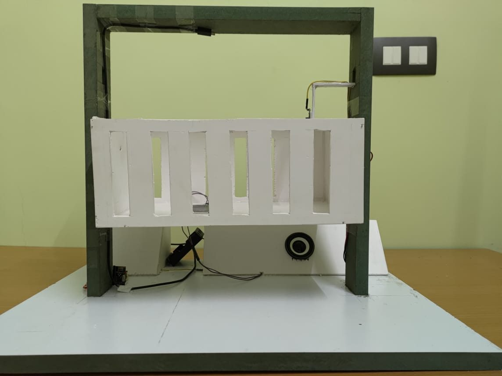
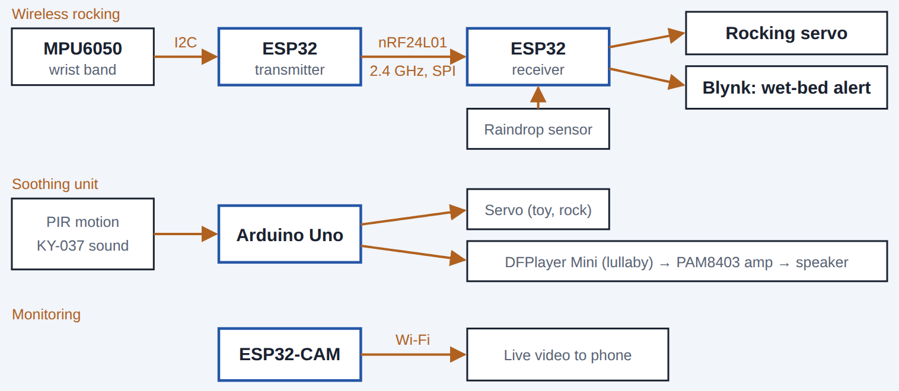
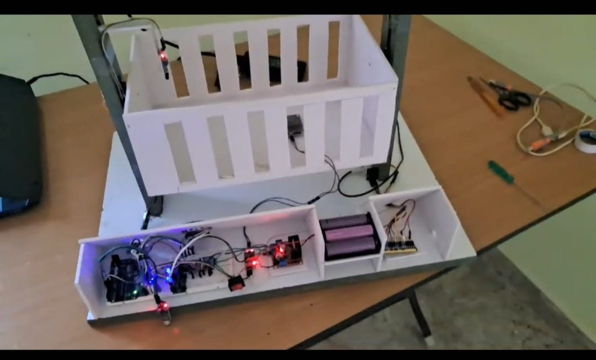

# Smart Baby Cradle System

A smart cradle that watches over a sleeping baby and soothes it automatically. When the baby cries, it plays a lullaby; when the baby moves, it rocks; when the bed is wet, it alerts the parent's phone; and a camera streams live video. A wireless wrist band lets a parent rock the cradle with a hand gesture from across the room.

Final-year project (3-person team), Thiagarajar College of Engineering, Dec 2023 to Apr 2024.



## Demo

- [Live demo of the working prototype](videos/demo.mp4)
- [3-D CAD walkthrough of the cradle assembly](videos/cad_walkthrough.mp4)

## System architecture



The system is split into 3 subsystems on 4 boards:

| Subsystem | Board | What it does |
|---|---|---|
| Wireless rocking | ESP32 (wrist band) + ESP32 (receiver) | The band reads an MPU6050 accelerometer over I2C and sends the readings over an nRF24L01 2.4 GHz radio (SPI). The receiver maps wrist tilt to a servo angle to rock the cradle, and checks a raindrop sensor for a wet bed. |
| Soothing unit | Arduino Uno | A PIR sensor triggers servo movement; a KY-037 sound sensor detects crying and a DFPlayer Mini plays a lullaby through a PAM8403 amplifier and speaker. |
| Monitoring | ESP32-CAM | Streams live video to a phone over Wi-Fi. |

## Hardware

- 2x ESP32, 1x Arduino Uno, 1x ESP32-CAM
- MPU6050 accelerometer/gyroscope (I2C)
- 2x nRF24L01 2.4 GHz radio modules (SPI)
- PIR motion sensor, KY-037 sound sensor, raindrop (water) sensor
- Servo motors
- DFPlayer Mini (UART) with PAM8403 amplifier and speaker
- Blynk IoT app for phone alerts



## How it works

1. **Gesture rocking:** the wrist-band ESP32 reads the accelerometer every 100 ms, packs the X/Y/Z values into a text packet, and sends it over the nRF24L01 link. The receiver parses the packet and maps the X-axis tilt (-16000 to 16000) to a servo angle (0 to 180 degrees).
2. **Wet-bed alerts:** the receiver checks the raindrop sensor on a non-blocking 2.5 s Blynk timer and sends one phone notification each time the bed becomes wet, so the alert never blocks rocking.
3. **Soothing:** the Uno moves a servo when the PIR sensor detects motion, and plays a lullaby when the sound level crosses a threshold.
4. **Monitoring:** the ESP32-CAM runs the standard Arduino-ESP32 `CameraWebServer` example (AI-Thinker pin map) and streams video to any browser on the same network.

## Firmware

```
firmware/
├── wristband_transmitter/   ESP32: MPU6050 (I2C) -> nRF24L01 (SPI)
├── cradle_receiver/         ESP32: nRF24L01 -> servo, raindrop sensor -> Blynk alert
└── soothing_unit/           Arduino Uno: PIR -> servo, sound sensor -> DFPlayer Mini
```

Built with the Arduino IDE. Libraries: `MPU6050`, `RF24`, `ESP32Servo`, `Blynk`, `DFRobotDFPlayerMini`, `Servo`.

Before uploading, replace `YOUR_WIFI_NAME`, `YOUR_WIFI_PASSWORD`, `YOUR_TEMPLATE_ID` and `YOUR_BLYNK_AUTH_TOKEN` with your own values.

## My role

I came up with the concept and led the feature brainstorming (automatic rocking, lullabies, wet-bed alerts, camera monitoring and gesture control), coordinated the team, modeled the cradle assembly in 3-D CAD, led integration testing one board at a time across the I2C, SPI and UART links, and presented the final prototype.

## What I would improve

- **Non-blocking timing everywhere:** the soothing unit still uses `delay()` (including a 15 s wait while the lullaby plays), which freezes the board. I would replace it with `millis()`-based timers, like the receiver's Blynk timer.
- **Smoother rocking:** filter the accelerometer readings (for example a moving average or complementary filter) so small hand tremors don't jitter the servo.
- **Link loss handling:** return the servo to a safe resting position if no radio packet arrives within a timeout.
- **Custom PCB:** move the breadboard wiring onto a PCB for reliability.
